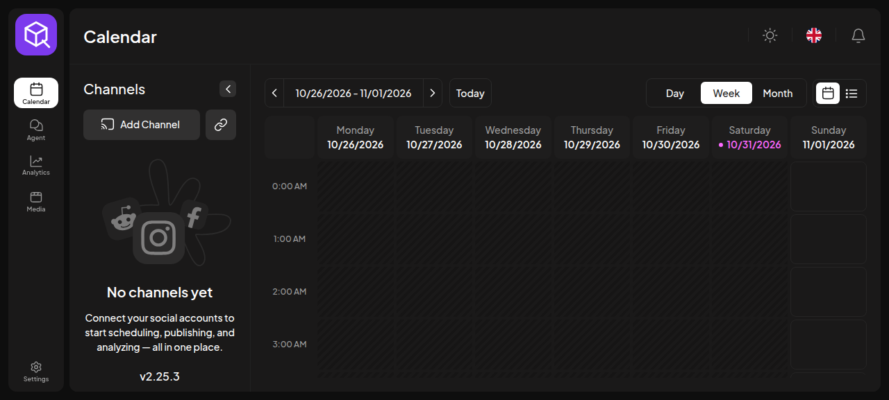
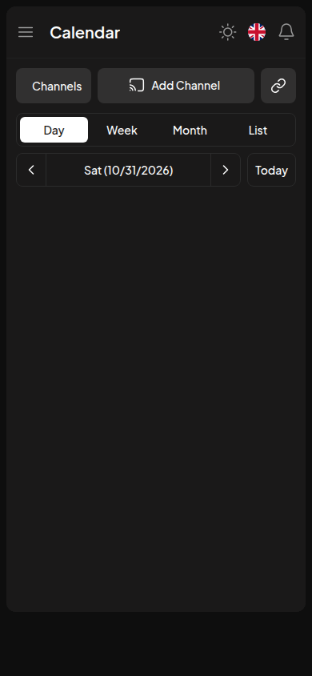
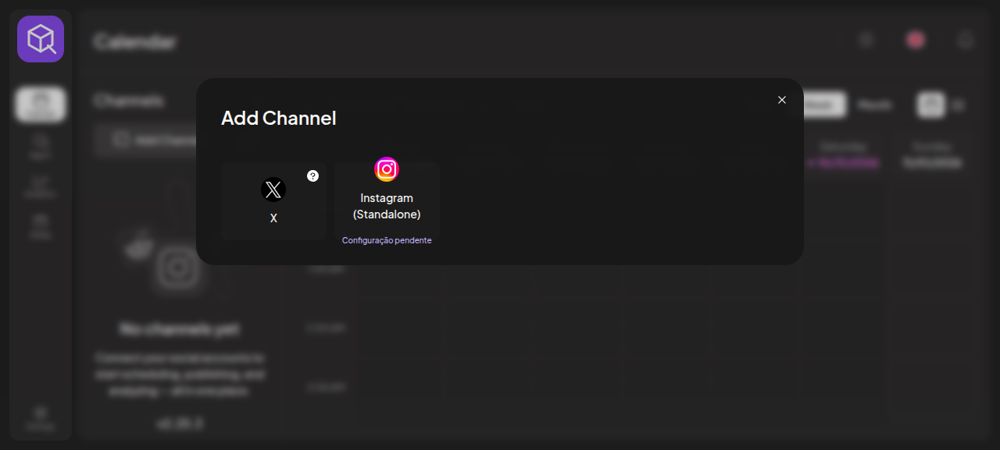

<p align="center"></p>

<h1 align="center">Your content. Your next move.</h1>
<p align="center">An open-source social publishing workspace, based on Postiz.</p>
<p align="center"><a href="LICENSE">AGPL-3.0</a> · <a href="https://drdrey7.github.io/postqube/">Documentation</a> · <a href="docs/postqube/GETTING-STARTED.md">Get started</a> · <a href="docs/postqube/LAUNCH.md">Launch readiness</a></p>

> **Public beta, not a finished commercial launch.** The test deployment is at
> https://postqube.ownthecrown.lol. Domain may change. X is connected in the owner's
> workspace; each user must authorize their own channel. Instagram remains pending
> Meta configuration. AI, transactional email and payments are not configured.



## What is Postqube?

Postqube gives this independent project its own identity while preserving the
Postiz scheduling engine, accounts, workspaces and upstream update path.
The complete upstream source is kept here; Postqube-specific presentation and
operations files are easy to find. See [provenance and changes](UPSTREAM.md).

## What you can test

| Capability | State |
| --- | --- |
| Email/password signup; optional company | Verified with disposable accounts |
| Separate workspaces | Verified |
| Ideas: instant notes, optional folders, search and tasks | Native page/API, shared within each workspace |
| Desktop/mobile calendar | Visually checked at 1440×1000 and 390×844 |
| X connection and native API | Verified; paid live publishing not retested |
| Instagram image/carousel/Reel/Story support | Native upstream capability; connection not activated |
| Owner activity/error administration | Access verified; not a full user/cost dashboard |
| AI text assistant | Native code present; provider configuration required |
| Password reset / invitation email | Native code present; delivery configuration required |
| Subscriptions | Native code present; Stripe setup and testing required |

<table><tr><td width="30%"></td><td><p>Screenshots show an isolated empty test workspace. They do not contain customer data or imply Instagram is connected.</p></td></tr></table>

## Start here

- **Organize ideas:** [Ideas workspace](docs/postqube/IDEAS.md)
- **Use it:** [Getting started](docs/postqube/GETTING-STARTED.md) · [User guide](docs/postqube/USER-GUIDE.md)
- **Operate it:** [Deployment](docs/postqube/DEPLOYMENT.md) · [Backups and recovery](docs/postqube/OPERATIONS.md)
- **Connect channels:** [X and Instagram](docs/postqube/CHANNELS.md)
- **Extend it:** [Architecture](docs/postqube/ARCHITECTURE.md) · [Development](docs/postqube/DEVELOPMENT.md)
- **Maintain it:** [Upstream updates](docs/postqube/UPDATES.md) · [Security](docs/postqube/SECURITY.md)
- **Launch it:** [Readiness checklist](docs/postqube/LAUNCH.md) · [Legal/licensing](docs/postqube/LEGAL.md)
- **Understand limits:** [Status](docs/postqube/STATUS.md) · [FAQ](docs/postqube/FAQ.md)

## Quick preview of the documentation

```sh
python3 scripts/postqube/build-docs.py
python3 -m http.server 8088 --directory .postqube-site
```

Open http://localhost:8088. This serves documentation only, not the application.
For the application, follow [Deployment](docs/postqube/DEPLOYMENT.md). Do not run
the root upstream Compose file unchanged as a hardened public deployment.

## Ideas for your team

Create a page immediately, keep it unfiled or organize it in optional folders and
subfolders. Search all titles/text, move pages, pin important ideas and resume where
you stopped. Continuous text, formatting, circular tasks and autosave are native.
Shared with current workspace members; separate workspaces remain isolated.


Read the [Ideas guide](docs/postqube/IDEAS.md) for mobile navigation, collaboration
conflicts, backups and deployment.

## Repository map

```text
apps/                 Original frontend, backend, orchestrator and other apps
libraries/            Original shared product code
postqube/native/      Native build, schema and legacy migration instructions
postqube/branding/    Postqube UI customization and original SVG assets
postqube/deploy/      Sanitized configuration examples, not live credentials
postqube/release.json Exact release/upstream/runtime provenance
scripts/postqube/     Validation, documentation and operator helpers
docs/postqube/        Human-readable guides and real screenshots
UPSTREAM.md           Original project attribution and modification record
NOTICE.md / LICENSE   Notices and license
```

## Commercial use and source

You may charge for hosting/support while complying with the AGPL and applicable
third-party terms. Offer users the source corresponding to the running version.
Keep copyright/license notices and modification records. Credentials and customer
data stay private. This is not a proprietary relicensing of Postiz. See
[LICENSE](LICENSE), [notices](NOTICE.md) and [legal readiness](docs/postqube/LEGAL.md).

**Polotno needs its own production license.** Platform APIs, media rights and
provider billing are separate. Public source does not remove those obligations.

## Contributing

Open focused issues/PRs against this project's `postqube` branch. Follow
[Postqube contribution guidance](docs/postqube/CONTRIBUTING.md). No unsolicited
publishing, live customer data or secrets in tests/issues. The original upstream
contribution documents remain in the repository for provenance; they do not
automatically require a Postqube contributor to sign an upstream CLA.
