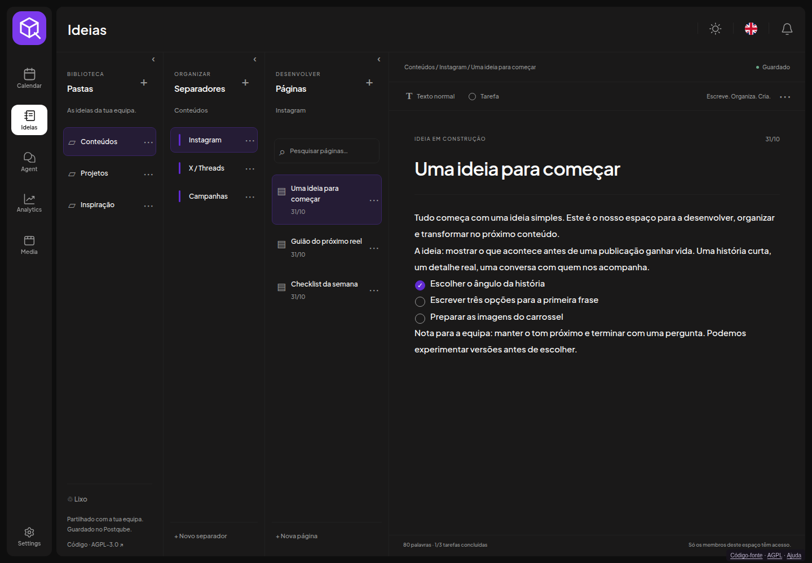
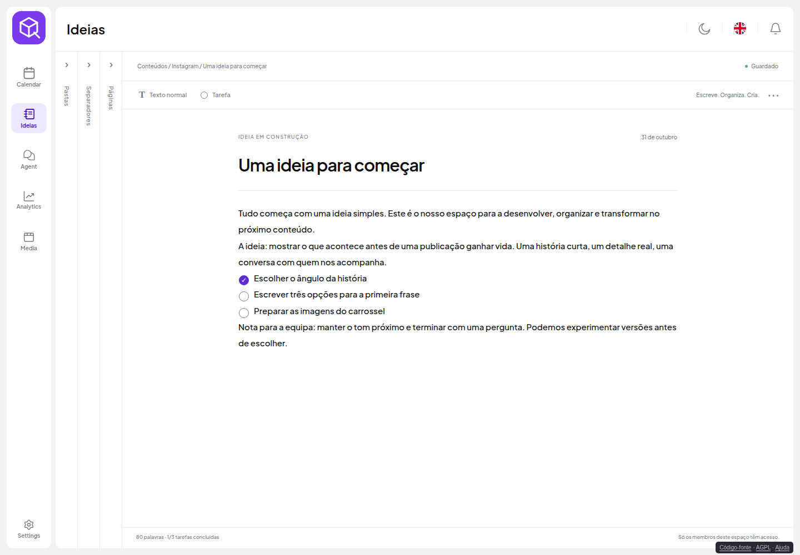
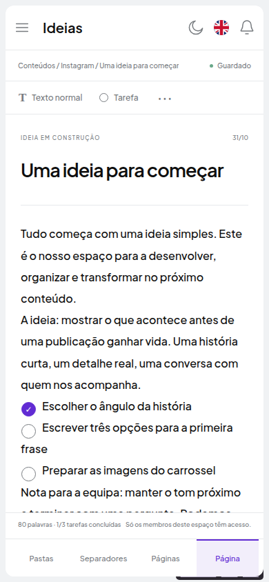

# Ideias — native shared workspace notes

Open Ideas in the existing application menu or visit /ideas. This is a native
React/Next.js page in the shared application layout. The existing MenuItem uses
Next Link, so Calendar ↔ Ideas changes the route without reloading the document.
There is no iframe or separate page shell. Original sidebar, header, workspace,
light/dark, language and notification controls remain native.

Screenshots use disposable demonstration text; never customer notes.

## Organize and write

Folders → Sections → Pages → Editor. Each column has a creation button and an
independent minimize/expand control; preferences stay in the browser. On mobile,
the bottom tabs move between levels rather than squeezing four narrow columns.

The note is one continuous editing surface. Put the cursor before a word and click
Tarefa: the task circle inserts at that point. Click to complete/reopen. Enter in
a task continues the checklist; an empty task exits it. Texto normal removes the
current task marker without deleting text. Paste inserts plain text and preserves
line breaks. Text and marker insertion use the browser undo/redo history.

## Teams, authentication and storage

Ideas belong to the current native workspace. Active members can read and edit;
other workspaces are isolated. Add people through native team settings; invitation
delivery still requires the email service to be configured.

The Nest IdeasController is registered with native AuthMiddleware. Identity and
workspace membership are resolved by the original authentication system. Notes
use PostgreSQL/Prisma IdeaItem records related to Organization; a composite parent
foreign key prevents references to another workspace. There is no second session
verification service, SQLite runtime or provider key requirement.

## Saving and recovery

Autosave runs after typing. Wait for Guardado before closing. Network failures
keep the note in the editor and a per-tab recovery draft. Navigating inside the
application flushes pending changes when the page unmounts. Drafts are scoped to
workspace, user and note. They do not replace server backups.

A stale revision returns 409. The editor keeps local text and offers copy, save as
a new page or open the latest version. No silent overwrite or real-time shared
cursor editing is claimed. Trash hides content with soft deletion; restore parents
before children when needed. No permanent-delete UI is provided.

## Deployment, migration and updates

See [native distribution](../../postqube/native/README.md). Build the native
frontend, backend and Prisma client from the tracked source; deploy the resulting
Postqube image using the existing protected Compose environment/networks/volumes.
The standard app and API reverse proxies handle /ideas and /api/ideas. Remove the
legacy /ideas proxy exception and retire the separate Ideas container.

The migration tool imports legacy SQLite notes transactionally, preserving IDs,
parents, content, task states, revisions, dates and trash. It verifies each field
and refuses to overwrite a different native record. Keep a protected pre-migration
snapshot for rollback. The original SQLite files remain intact during migration.
The old /launches?view=ideas bookmark redirects to /ideas.

Native PostgreSQL backups now cover Ideas. Restore and test the native database
alongside the matching image/source version. Legacy snapshots still follow the
operator's retention/deletion policy. Before commercial launch, verify the complete
shared-workspace deletion/export/backup lifecycle and off-server recovery drill.
