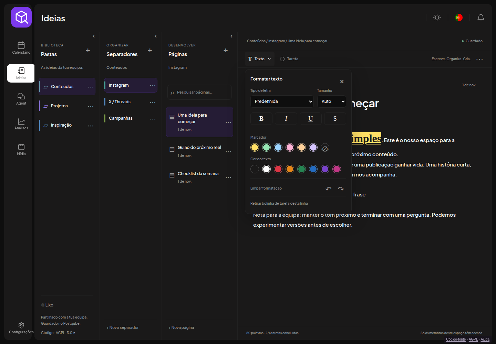

# Ideas — write first, organize when you want

Open Ideas in the native application menu or visit /ideas. Start with **All ideas**
and **New idea**. A blank page opens immediately with focus in the writing area;
no folder, subfolder or naming dialog is required.

Screenshots use disposable demonstration text; never customer notes.

## Optional organization

All three workflows are supported:

- Ideas → Page.
- Ideas → Folder → Page.
- Ideas → Folder → Subfolder → Page, with further nesting when needed.

A folder can contain pages and subfolders at the same time. Existing sections are
shown as folders; IDs, parent relationships, content, revisions and dates remain
intact. Nothing is moved merely by installing the update.

**Organize** opens a collapsible folder panel with All ideas, Unfiled, Pinned,
your folder tree and Trash. Unfiled is a view of root pages; it is not a compulsory
hidden folder. Creating a page uses the selected folder, or the workspace root
when viewing All ideas, Unfiled or Pinned. The creation location is displayed.

Use **Move to…** in the page/folder menu or the note's location at the top.
The desktop also supports dragging pages or folders onto a folder, or onto
All ideas/Unfiled to move to the root. A folder cannot move into itself or its
own descendants. Location changes do not change workspace sharing permissions.

## Finding and resuming ideas

Search covers titles and complete text throughout the current workspace, including
ideas outside the selected folder. Clear the search to return to that folder.
The list shows titles, text previews, dates and locations. Sort by last edit,
creation date or title. Pinned pages stay at the top; pins are shared in the workspace.

Untitled pages use the first text line as their display title. Editing the title
creates an explicit title that stays independent of later body edits. Clear it
to return to the first-line title. The underlying note text is never rewritten.

The last page, folder/filter, sorting and panel preferences are remembered in this
browser, scoped to the native user and workspace. They are not cross-device sync.

## Desktop and mobile

The default desktop view has a page list and editor inside the existing native
application shell. Organization and list panels can be collapsed. On intermediate
screens the organization panel overlays the list instead of compressing the editor.

On mobile, the list opens into a full-screen note and **Ideas** returns to the list.
There are no permanent Folder/Section/Page level tabs. The native header, theme,
language and notification controls remain in their original places. Word/task
counts and sharing information are available through the current note's details.

## Native formatting and language

Folders have thin, stable colored accents. The Text menu provides font family,
size, bold, italic, underline, strikethrough, highlighting, text color, clear
formatting and undo/redo. Formatting survives autosave and reopening. Rich text
is stored as validated text runs, never executable HTML or arbitrary CSS.

The note is one continuous editing surface. Put the cursor before a word and click
Task: its circle appears there. Click to complete/reopen. Enter in a task continues
the checklist; an empty task exits it. The Text menu can remove the task marker
from the current line. Paste inserts plain text with line breaks.

Menu, workspace, dialogs, accessible labels, placeholders and save states use the
same useT/i18next resources as the rest of the app, in all 14 supported languages.
Language changes preserve note content and editor state. User notes are not translated.

## Teams, authentication and storage

Ideas belong to the current native workspace. Active members can read and edit;
other workspaces are isolated. Add people through native team settings; invitation
delivery requires the email service to be configured. Unfiled does not mean private.

The Nest IdeasController uses native AuthMiddleware and PostgreSQL/Prisma IdeaItem.
The composite parent foreign key enforces workspace boundaries. Generic container
ancestry checks hide trashed subtrees and reject invalid destinations and cycles.
Organization hierarchy mutations are serialized to prevent concurrent reciprocal
moves from creating a cycle. There is no second session service or SQLite runtime.

## Saving and recovery

Autosave runs after typing. Wait for Saved before closing. Network failures keep
text in the editor and a per-tab recovery draft scoped to workspace, user and note.
Native navigation flushes pending edits. Drafts do not replace server backups.

Stale revisions return 409. The editor preserves local text and offers copying,
saving to a new page or opening the latest version. Move/pin requests queue content
saves and preserve text entered during the request. No real-time shared cursor
editing is claimed. Trash uses soft deletion; restore parent folders first when
needed. There is no permanent-delete UI.

## Deployment and updates

See [native distribution](../../postqube/native/README.md). Back up PostgreSQL and
apply `postqube/native/ideas-flexible.sql` before deploying this version. It adds
only a pinned boolean; it does not rename, reparent or rewrite existing records.
Build and deploy the native frontend/backend/Prisma client using the protected
Compose environment, networks and volumes. The normal native routes handle
/ideas and /api/ideas; no iframe or alternate app shell is involved.

Native PostgreSQL backups include Ideas. Keep matching source/image versions and
perform off-server restore drills before commercial launch. The 0.4 runtime cannot
show new root pages or arbitrary nesting; once the new hierarchy is used, prefer a
forward fix rather than reverting to that older interface. Existing data is retained.

[Current beta release validation](RELEASE-BETA.md)
